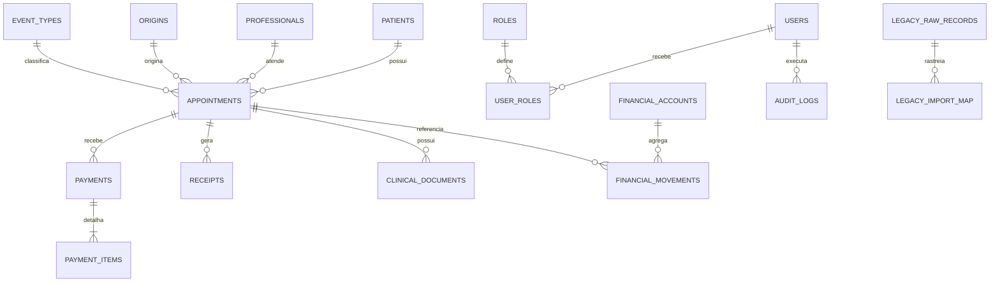

# Fase 3 - Modelo relacional

## Topologia

- MySQL 8.4.9 local, porta 3307, acesso restrito a `127.0.0.1`.
- Banco `abel_clinica`, InnoDB e `utf8mb4`.
- Credenciais somente em `.env` e `data/mysql-root.secret`, ambos ignorados.
- Alembic é a fonte de verdade do schema; revisão inicial `52f8e516cc0a`.

## Domínios

## Integridade

O schema contém 18 tabelas de domínio, 18 chaves estrangeiras e 6 constraints de
checagem. Valores financeiros usam `DECIMAL(12,2)`; identificadores legados e
documentais permanecem textuais; datas civis usam `DATE` e eventos usam `DATETIME`.

O ciclo `upgrade -> downgrade base -> upgrade head` foi executado no MySQL real.
O resultado detalhado está em `docs/fase_3_validacao_schema.json`.
