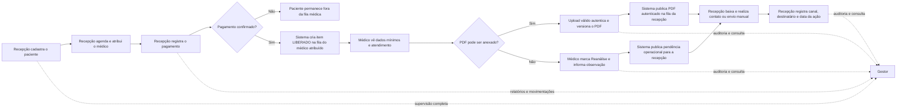
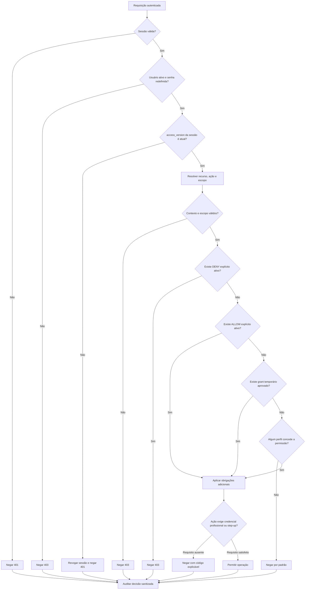
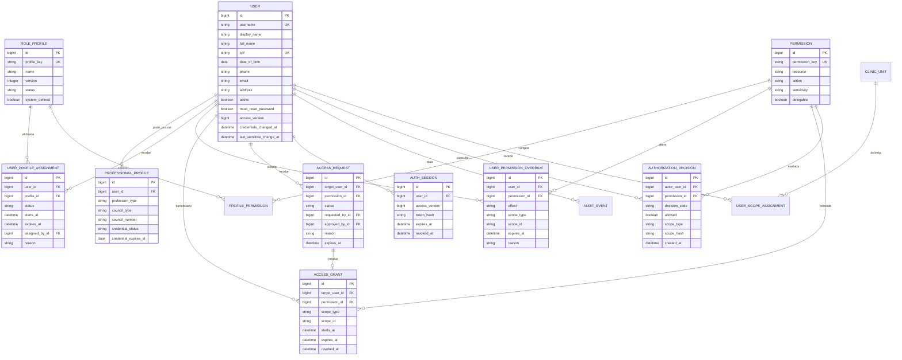
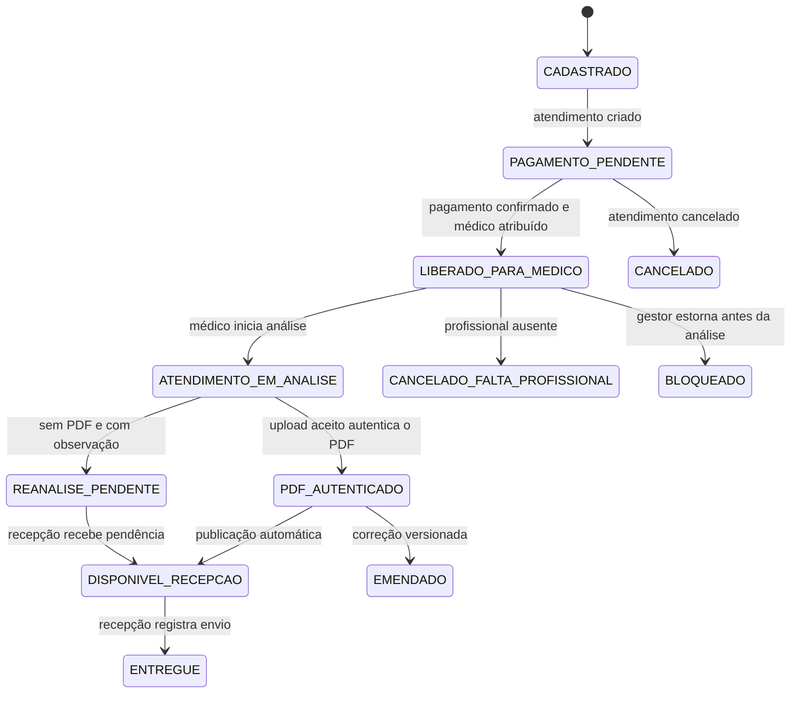
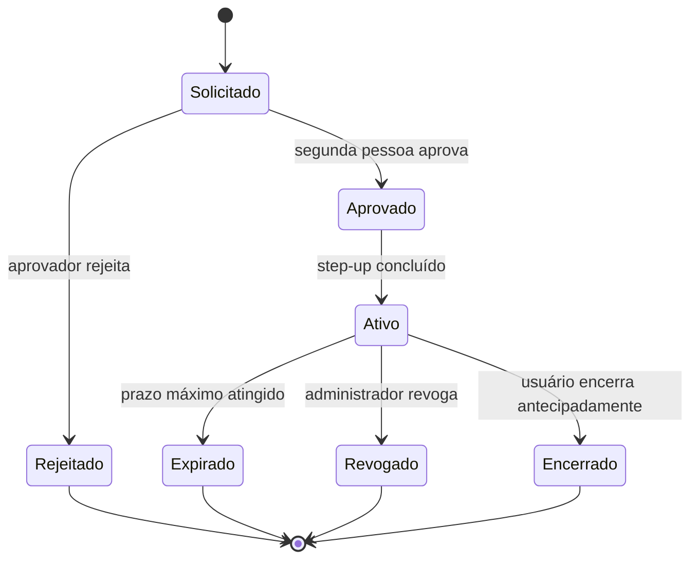
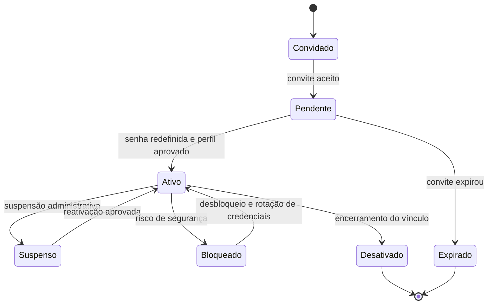

# Modelo de gestão de usuários e permissões do ABEL

Status: **schema multiusuário validado estaticamente — migration ainda não aplicada**
Aplicação de referência: **ABEL 1.0.0+build.53**
Data: **2026-11-02**

## 1. Objetivo

Formalizar o RBAC atual em exatamente três níveis humanos — `GESTOR`, `RECEPCAO`
e `MEDICO` — com permissões internas explícitas e um fluxo operacional encadeado,
adequado a uma clínica credenciada pelo DETRAN, sem importar para o ABEL toda a
complexidade multi-Workspace do FISIA.

O modelo combina:

- grupos e objetos de acesso do OpenEMR;
- perfis, permissões, escopos, exceções e auditoria do FISIA;
- os controles já existentes no ABEL: sessão server-side, CSRF, troca obrigatória
  de senha, vínculo profissional, auditoria e bloqueio otimista.

### 1.1 Solicitações operacionais extraídas das imagens

As transcrições das mensagens e as orientações posteriores foram interpretadas
como requisitos do negócio. O upload aceito já autentica o PDF no ABEL e registra
hash, autor, data/hora, atendimento e versão. Não existe uma segunda ação de
finalização no fluxo do usuário nem integração ICP-Brasil neste escopo.

1. Existem três níveis de usuário: gestor, recepção e médico.
2. O gestor enxerga toda a operação e é o único perfil com relatórios financeiros
   agregados, movimentação mensal e filtros por período.
3. Somente o gestor cria usuários. O cadastro exige nome completo, CPF, data de
   nascimento, telefone, e-mail e endereço. Profissional exige CRM ou CRP.
4. A recepção cadastra pacientes, mantém os dados administrativos e registra o
   pagamento.
5. Pagamento confirmado é obrigatório; não há convênio, urgência excepcional,
   cortesia, liberação sem pagamento ou pagamento posterior.
6. Somente o gestor realiza estorno.
7. O médico não vê pagamentos, valores, formas de pagamento ou relatórios.
8. O paciente só aparece para o médico quando estiver pago e atribuído a ele.
9. Se o profissional faltar, não há atendimento, reatribuição ou substituição.
10. O upload aceito já cria o PDF autenticado e o publica para a recepção.
11. Sem PDF, o médico marca `Reanálise` e preenche uma observação operacional
    obrigatória para a recepção entrar em contato com o paciente.
12. A recepção realiza o contato e eventual envio por WhatsApp manualmente; o
    ABEL apenas registra a ação e não se integra diretamente ao WhatsApp.

“Pessoas que a recepção cadastrou” foi interpretado como descrição do fluxo, não
como propriedade individual do cadastro. Restringir cada paciente ao recepcionista
que o criou impediria continuidade entre turnos. A recepção pode operar os dados
administrativos da clínica, mas nunca conteúdo clínico em elaboração.

## 2. Evidência analisada

### OpenEMR usado como referência pelo FISIA

O checkout de referência está no commit
`89465dfb3a14cd58a0191e95a1f1ea7bb62d8332`, exatamente o commit registrado no
baseline do FISIA.

Elementos reaproveitados conceitualmente:

- negação por padrão e concessão por necessidade;
- ACOs: objetos protegidos agrupados por domínio;
- AROs: usuários associados a um ou mais grupos, acumulando privilégios;
- grupos padrão separados para administração, clínica, recepção e financeiro;
- níveis de ação distintos, como leitura, inclusão e alteração;
- sensibilidade normal ou alta para informações do paciente;
- proteção do grupo administrativo contra exclusão ou descaracterização acidental;
- acesso emergencial auditável.

O ABEL **não deve copiar literalmente** o grupo persistente e amplo de
`Emergency Login`. O equivalente será um grant temporário, com justificativa,
expiração, autenticação reforçada e aprovação por outra pessoa.

### FISIA

Elementos adotados:

- catálogo `recurso.ação` e perfis versionados;
- perfis derivados de catálogo de permissões;
- escopo por unidade, profissional, atendimento ou próprio usuário;
- `DENY` explícito prevalecendo sobre qualquer `ALLOW`;
- permissões temporárias e revogação lógica;
- proibição de autoelevação e de administrar par ou superior;
- proteção do último proprietário/administrador;
- permissões privilegiadas não delegáveis;
- `access_version` para invalidar sessões e evitar alterações concorrentes;
- modos `COMPAT`, `SHADOW` e `ENFORCE` para implantação progressiva;
- decisão de autorização explicável e auditada.

## 3. Diagnóstico do ABEL atual

O banco já suporta vários papéis por usuário por meio de `users`, `roles` e
`user_roles`, mas a API administrativa aceita somente um dos três nomes
fixos e substitui a associação anterior. A autorização é realizada diretamente
nas rotas por listas de papéis.

Consequências atuais:

- `gerente` concentra usuários, relatórios, financeiro e administração;
- `atendente` pode operar cadastro, agenda e recebimentos;
- `medico` representa profissionais clínicos de naturezas distintas;
- não existe catálogo de permissões independente dos papéis;
- não existem exceções com prazo, aprovação ou escopo;
- uma mudança de perfil não possui `access_version` próprio para invalidar de
  imediato todas as sessões daquele usuário;
- a interface esconde módulos por perfil, mas a API continua sendo a autoridade,
  como deve ser.

## 4. Princípios do modelo ABEL

1. Negar por padrão.
2. Autorizar no servidor; a interface apenas reflete a decisão.
3. Separar identidade, vínculo profissional, nível de usuário e permissão.
4. Cada usuário possui um único nível operacional ativo por vez.
5. O gestor pode visualizar todo o processo, mas só pode praticar ato clínico ou
   autenticar um documento se também possuir CRM ou CRP ativo.
6. O médico acessa apenas atendimentos pagos, ativos e atribuídos a ele.
7. `DENY` explícito e escopo inválido vencem qualquer concessão.
8. Assinar laudo, estornar, reconciliar, restaurar backup e gerir acessos são
   ações privilegiadas.
9. Nenhuma pessoa aprova a própria elevação de acesso.
10. Mudanças sensíveis exigem motivo, versão esperada e auditoria antes/depois.
11. Grants e perfis são revogados logicamente, nunca apagados da trilha histórica.
12. O último administrador ativo não pode ser suspenso ou rebaixado.

## 4.1 Fluxo operacional solicitado

O médico recebe apenas `LIBERADO_PARA_ATENDIMENTO`. O motivo financeiro da
liberação é avaliado no servidor e não é exposto como pagamento, valor ou forma.

## 5. Arquitetura de autorização

Precedência canônica:

1. sessão/contexto inválido;
2. usuário inativo ou provisionamento incompleto;
3. versão de acesso obsoleta;
4. escopo inválido;
5. `DENY` explícito;
6. `ALLOW` explícito;
7. grant temporário aprovado;
8. `ALLOW` herdado de perfil;
9. negação por ausência de concessão;
10. obrigações adicionais da ação.

## 6. Modelo de dados

## 7. Três níveis de usuário

| Capacidade | `GESTOR` | `RECEPCAO` | `MEDICO` |
|---|:---:|:---:|:---:|
| Cadastrar e editar dados administrativos | Sim | Sim | Não |
| Criar, suspender ou alterar usuário | Sim | Não | Não |
| Agendar e atribuir médico | Sim | Sim | Não |
| Registrar pagamento/recibo | Sim | Sim | Não |
| Estornar pagamento | Sim | Não | Não |
| Ver valor ou forma de pagamento | Sim | Somente na operação que executa | Não |
| Ver movimentação e relatório por período | Sim | Não | Não |
| Ver fila clínica paga e atribuída | Sim | Não | Sim |
| Enviar e autenticar PDF | Sim, se profissional habilitado | Não | Sim |
| Marcar Reanálise e informar observação | Sim, se profissional habilitado | Visualiza para contato | Sim |
| Ver PDF autenticado | Sim | Sim | Sim, dentro do próprio escopo |
| Encaminhar PDF manualmente ao paciente | Sim | Sim | Não |
| Gerir usuários e permissões | Sim | Não | Não |
| Auditoria completa | Sim | Não | Não |

### `GESTOR`

- visão completa de pacientes, agenda, documentos, usuários, auditoria e
  financeiro;
- relatórios diário, mensal, anual e personalizado;
- filtros por período, usuário responsável, forma e situação do pagamento;
- é o único perfil que cadastra, suspende e redefine usuários;
- exige nome completo, CPF, nascimento, telefone, e-mail e endereço no cadastro;
- para profissional, exige conselho `CRM` ou `CRP` e respectivo registro;
- é o único perfil que realiza estorno;
- pode corrigir ou supervisionar qualquer etapa do fluxo;
- praticar ato clínico ou autenticar PDF continua condicionado a credencial profissional
  válida, mesmo que o gestor consiga visualizar o documento.

### `RECEPCAO`

- cadastra e atualiza somente dados demográficos/administrativos;
- agenda o paciente e atribui o médico;
- registra pagamento e emite recibo;
- não cria usuários e não realiza estorno;
- não acessa relatórios financeiros agregados,
  reconciliação ou conteúdo clínico em elaboração;
- recebe PDFs no estado `PDF_AUTENTICADO` ou itens `REANALISE_PENDENTE`;
- na reanálise, visualiza somente o checkbox e a observação operacional necessária
  ao contato, nunca rascunho clínico;
- baixa o PDF, realiza o contato ou envio manual e registra a ação. O ABEL não
  envia diretamente pelo WhatsApp.

### `MEDICO`

- possui uma única página operacional simples;
- vê somente pacientes simultaneamente `PAGOS`, `ATRIBUIDOS_A_ELE` e com
  atendimento ativo;
- recebe apenas dados mínimos necessários: identificação, data, tipo do exame e
  observação administrativa autorizada;
- não recebe valor, forma de pagamento, recibo ou movimentação financeira;
- envia o PDF para o atendimento correto; o upload aceito já autentica e publica;
- se não puder anexar o PDF por falta de documentos ou reprovação nos critérios,
  marca `Reanálise` e informa observação operacional obrigatória;
- após autenticado, não substitui silenciosamente o arquivo: uma correção gera
  nova versão ou emenda auditada.

Gestor, recepção e médico são níveis mutuamente exclusivos. O vínculo
profissional permanece uma entidade separada para validar CRM ou CRP e autoria
do PDF. `MEDICO` é o nome do perfil operacional clínico e, neste modelo, aceita
profissional registrado em CRM ou CRP.

## 7.1 Estados do atendimento e do documento

O servidor calcula os estados. Nenhum perfil pode promover manualmente um
atendimento para a fila médica apenas alterando HTML ou enviando um campo no
corpo da requisição.

## 8. Escopos

| Escopo | Aplicação |
|---|---|
| `SELF` | conta, sessões e troca de senha do próprio usuário |
| `CLINIC` | operação global da clínica |
| `UNIT` | unidade física futura |
| `ASSIGNED` | atendimentos/pacientes atribuídos ao profissional |
| `PROFESSIONAL` | agenda ou produção de um profissional específico |
| `RESOURCE` | registro individual, usado em exceções pontuais |

Para o primeiro ciclo do ABEL, `CLINIC`, `SELF` e `ASSIGNED` são suficientes.
`UNIT` deve permanecer no contrato, mas não precisa ser implementado antes de
existirem múltiplas unidades reais.

## 9. Acesso emergencial

Regras:

- duração padrão de 30 minutos e máxima de 60 minutos;
- solicitante e aprovador diferentes;
- motivo com no mínimo 20 caracteres;
- recurso e escopo explícitos;
- autenticação reforçada antes da ativação;
- banner visível durante o acesso;
- auditoria de todas as leituras e mutações realizadas;
- proibição de conceder `access.manage`, `clinical.sign`, `finance.reconcile`
  ou `backup.restore` por break-glass comum.

## 10. Ciclo de vida do usuário

Cada transição sensível incrementa `access_version`; sessões com versão anterior
são recusadas imediatamente.

## 11. Regras de governança

- somente `GESTOR` com `access.manage` administra níveis;
- autoelevação é proibida;
- não é permitido conceder permissão que o ator não possua ou que seja marcada
  como não delegável;
- o último `GESTOR` ativo é protegido;
- operações privilegiadas exigem motivo e versão esperada;
- `clinical.sign`, `finance.reconcile`, `backup.restore` e mudanças de
  `GESTOR` exigem step-up;
- elevação para `GESTOR`, restauração de backup e grants
  emergenciais exigem dupla aprovação;
- suspensão, revogação e troca de perfil revogam sessões ou incrementam
  `access_version` na mesma transação;
- toda decisão registra código, fontes da concessão, escopo e correlação, sem
  copiar prontuário, senha, cookie ou token para o log.

## 12. Adaptação técnica do ABEL

### Banco e domínio

- manter `users`, `roles` e `user_roles`, mas semear somente `GESTOR`,
  `RECEPCAO` e `MEDICO` como níveis humanos ativos;
- permitir criação de usuário somente ao `GESTOR` e exigir nome completo, CPF,
  data de nascimento, telefone, e-mail e endereço;
- exigir `council_type` (`CRM` ou `CRP`) e `council_registration` para profissional;
- garantir no banco no máximo um nível ativo por usuário;
- adicionar `users.access_version` para invalidar sessões após troca de nível;
- usar o `professional_id` já existente para atribuir o atendimento ao médico;
- calcular a liberação clínica a partir de pagamento confirmado, atendimento
  ativo e profissional atribuído;
- não oferecer liberação por convênio, urgência excepcional, cortesia ou pagamento
  posterior; campos legados relacionados serão analisados separadamente antes de
  eventual remoção do banco;
- representar falta profissional como `CANCELADO_FALTA_PROFISSIONAL`, sem
  reatribuição ou substituição;
- adicionar `reanalysis_required` e `operational_observation`, sendo a observação
  obrigatória quando não houver PDF;
- adicionar estado de workflow ao documento e uma tabela `document_deliveries`
  com documento, paciente, recepcionista, canal, destinatário mascarado,
  horário, resultado e auditoria;
- preservar versões anteriores de PDF; correção nunca sobrescreve o autenticado
  e estorno nunca apaga documento ou auditoria.

### API proposta

| Método e rota | Perfil | Finalidade |
|---|---|---|
| `GET /api/clinical/worklist` | Médico | Fila somente de atendimentos pagos e atribuídos |
| `POST /api/documents/appointments/{id}` | Médico | Valida, autentica, versiona e publica o PDF atomicamente |
| `POST /api/clinical/appointments/{id}/reanalysis` | Médico | Marca Reanálise e grava observação operacional obrigatória |
| `GET /api/documents/delivery-queue` | Recepção | Lista PDFs autenticados e pendências de Reanálise |
| `POST /api/documents/{id}/dispatch` | Recepção | Registra contato ou entrega manual ao paciente |
| `POST /api/finance/payments/{id}/reverse` | Gestor | Estorna sem apagar documento autenticado ou entregue |
| `GET /api/finance/report` | Gestor | Relatório e movimentação por período |

O endpoint de worklist retorna `clinical_release_status=LIBERADO`, nunca os
campos financeiros que produziram a decisão.

### Interface

- gestor mantém dashboard completo, financeiro, relatórios e usuários;
- recepção recebe cadastro, agenda, recebimento, PDFs autenticados e itens de
  Reanálise, com contato/entrega manual;
- médico recebe uma tela única com fila, identificação mínima, upload que já
  autentica, checkbox Reanálise, observação e histórico das próprias versões;
- menus ocultos continuam sendo somente conveniência; a autorização permanece
  obrigatória na API.

## 13. Implantação progressiva

1. **Catálogo:** criar permissões e perfis sem alterar o comportamento.
2. **COMPAT:** manter o RBAC atual e calcular a nova decisão para inspeção.
3. **SHADOW:** comparar decisão antiga e nova; registrar divergências.
4. **ENFORCE administrativo:** usuários, perfis, auditoria e relatórios.
5. **ENFORCE financeiro:** pagamentos, estorno, reconciliação e exportações.
6. **ENFORCE clínico:** escopo profissional, documentos e assinatura.
7. **Grants e revisão:** acesso temporário, dupla aprovação e revisão periódica.

Cada etapa deve possuir teste positivo, teste negativo, teste de escopo e teste
de revogação de sessão. O rollout não deve depender da visibilidade do frontend.

## 14. Decisões operacionais consolidadas

1. Somente o `GESTOR` cria usuários e todos os campos cadastrais definidos são
   obrigatórios; profissional exige CRM ou CRP.
2. Pagamento confirmado é obrigatório e não existe atendimento por convênio,
   urgência excepcional, cortesia ou pagamento posterior.
3. Somente o `GESTOR` realiza estorno.
4. Na falta do profissional não há atendimento, reatribuição ou substituição.
5. O upload aceito já autentica o PDF; não existe etapa separada de finalização.
6. Estorno não apaga PDF autenticado ou entregue nem sua auditoria.
7. Sem PDF, o médico marca `Reanálise` e informa observação operacional que a
   recepção utiliza para entrar em contato com o paciente.
8. O contato e eventual envio por WhatsApp são manuais; não haverá integração
   direta do ABEL com WhatsApp.
9. Do FISIA serão adaptadas apenas as primitivas necessárias ao ABEL.
